# 팬꾹 화면 점검 — 변경 비교 (2026-11-21)

`작업범위.md`에서 「권고대로(시안 보고 확정)」로 정한 20줄의 지금 화면과 시안을 나란히 둔 문서다. **main 의 코드는 아직 고치지 않았다.** 시안은 별도 작업 폴더의 브랜치(원인마다 하나)에 실제로 적용해 찍었다.

줄마다 **결정** 칸에 「승인 / 고쳐서 승인 / 안 함」 중 하나를 적고, 고칠 점은 **메모** 칸에 적는다. 「승인」 줄만 구현하고, 「고쳐서 승인」 줄은 메모를 반영한 시안을 다시 보여 준다. 그림을 누르면 원본 크기로 열린다.

- 1부: 여러 화면 공통 11가지
- 2부: 흐름·구조 제안 9건 (1부 보고 뒤에 덧붙인다)

---

# 1부. 여러 화면 공통

## 1-1. 추천 크리에이터 카드가 큼(보조 영역)

**무엇을**: 크리에이터 상세(/creators/[id])와 개인 주소 페이지(/[handle]) 맨 아래 「추천 크리에이터 둘러보기」의 카드가, 위쪽 큰 배경 면 없이 얼굴 사진 + 이름 + 태그만 가로로 놓인 작은 카드로 바뀐다.

**왜**: 상세 페이지의 보조 영역인데 찾기 화면과 같은 큰 배경 카드(1440에서 카드 349×247)를 써서 주 내용보다 커 보였다 — design-prompt 8-14(보조 영역은 그림 64 이하 가로형 작은 카드, 높이 약 88~100).

**어떻게**

- 카드 모양: 위 2:1 배경 면 + 얼굴이 배경에 반쯤 걸친 세로 카드 → 얼굴 56 | 이름·태그가 나란한 가로 카드
- 카드 크기(1440): 349×247 → 349×88
- 카드 크기(390): 173×205 → 173×98 (휴대폰은 얼굴 48, 안쪽 여백 12. 태그가 둘이면 두 줄로 내려가 98)
- 얼굴 사진: 배경에 28 걸치던 위치와 흰 테두리 3 → 카드 안 세로 가운데, 바깥 고리만
- 그대로 둔 것: 한 번에 3장(휴대폰 2장), 5초 자동 넘김, 멈춤·화살표 버튼, 카드 전체가 링크, 카드 테두리·그림자·마우스 올림 효과
- design-rules 44절(2026-11-12 승인)의 「카드 = 배경 2:1 + 사진 56(배경에 28 걸침)」과 부딪힌다. 8-14가 더 나중(11-19) 사용자 승인이고 판정도 「작은 카드로 변경」이라 8-14를 따랐다 — 승인되면 44절의 추천 카드 줄과 실측 줄(배경 349×175)을 이 값으로 고쳐야 한다(이 브랜치에서는 문서를 고치지 않았다).

코드: src/widgets/creator-profile/ui/creator-profile-page.tsx(.otherCover 제거) · creator-profile.module.css(.other 가로 그리드 min-height 88, .otherFace 56/48) · tests/creator-detail-e-ui.test.tsx(배경 면 시험을 「배경을 그리지 않는다」로 교체)

**같이 바뀌는 곳**

- 개인 주소 페이지 /wikdhdl — 같은 화면 부품이라 같이 바뀐다(캡처 있음)
- 로그인 전·팬·크리에이터 모두 같은 카드(역할별 차이 없음)
- 문서: design-rules 44절 추천 카드 줄·실측 줄, docs/ux/pages/handle.md 에 카드 모양을 적은 줄이 있으면 함께 고쳐야 한다(승인 뒤)
- 추천 카드용 배경 사진 주소를 서버가 계속 읽어 넘긴다(load-creator-link.ts) — 화면에 안 쓰이니 승인 뒤 읽기를 빼도 된다(제안)

**비교**

| 화면 · 폭 | 지금 | 시안 |
|---|---|---|
| 크리에이터 상세 (/creators/00000000-0000-4000-b000-000000000001) · 1440 | <a href="compare/creator-card-recommend/before__creator-detail__1440.png">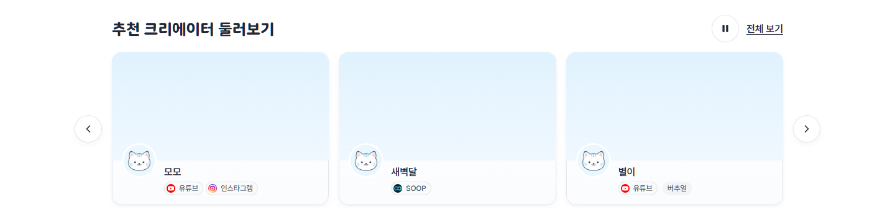</a> | <a href="compare/creator-card-recommend/after__creator-detail__1440.png">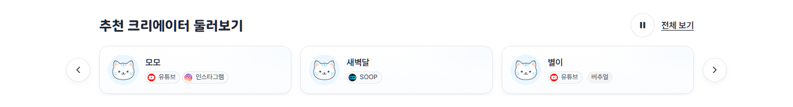</a> |
| 크리에이터 상세 (/creators/00000000-0000-4000-b000-000000000001) · 390 | <a href="compare/creator-card-recommend/before__creator-detail__390.png">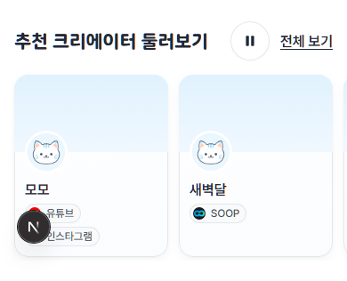</a> | <a href="compare/creator-card-recommend/after__creator-detail__390.png">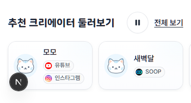</a> |
| 개인 주소 페이지 (/wikdhdl) · 1440 | <a href="compare/creator-card-recommend/before__handle__1440.png">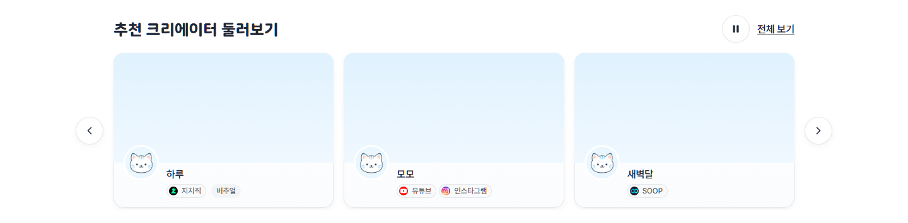</a> | <a href="compare/creator-card-recommend/after__handle__1440.png">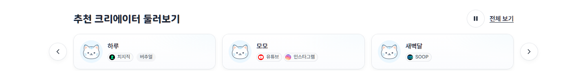</a> |
| 개인 주소 페이지 (/wikdhdl) · 390 | <a href="compare/creator-card-recommend/before__handle__390.png">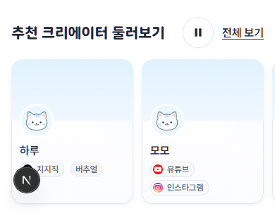</a> | <a href="compare/creator-card-recommend/after__handle__390.png">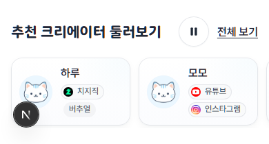</a> |

확인: document.fonts 에 Pretendard Variable·Tmoney Round Wind 로드 확인, 가로 넘침 1440·390 모두 0. 14-7: 카드가 이전보다 작아졌고(1), 한 줄 카드 크기·얼굴 크기가 같으며(3), 보조 영역에 맞는 작은 카드(6), 화살표는 줄 양옆 가운데(7) — 고칠 것 없음. · 시험: npx vitest run tests/creator-detail-e-ui.test.tsx 외 크리에이터 상세 화면 시험 5개 — 처음 1개 실패(옛 배경 면을 고정한 시험), 시험을 새 모양으로 바꾼 뒤 6파일 67개 통과 · 브랜치 `audit/creator-card-recommend` (6370ecc2)

**결정**: 승인 / 고쳐서 승인 / 안 함 → 승인 (2026-11-21 사용자 「다 추천대로」)

**메모**: 

---

## 1-2. 누르지 않는 회색 안내·요약 칸의 테두리

**무엇을**: 누르지 않는 회색 안내·요약 칸에서 바깥 1px 회색 선이 빠지고 회색 면만 남는다 — 승인 내역(/creator/requests)의 「승인·거절·기한 만료·차단」 숫자 칸, 보낸 역조공(/creator/revgifts)의 「팬의 주소와 실명은…」 안내 칸 등

**왜**: 누르는 칸이 아닌데 테두리가 있어 버튼처럼 보인다 — 누르지 않는 묶음은 여백으로만 나눈다(design-prompt 4-6, 1-3 판정 「테두리 제거」).

**어떻게**

- 회색 칸 테두리: 1px 회색(--gray-200) 선 → 없음
- 회색 면과 위쪽 흰 반사선은 그대로(design-rules 23-1 「회색 보조 카드: 그림자 없음, 위 반사선만」)
- 선물 보내기의 「반송·환불 안내」 회색 칸(/gifts/new)도 같은 1px 선 → 없음

코드: 9개 CSS 모듈의 muted-fx 칸 16곳(decided-request-list .grid>div, access-log .rule, revgift-sent .privacy·.guide, register-form .hardnote·.memo·.gnote(+surface-muted 변형), gift-reply .quote·.bside, box-apply .onFile·.sum, box-manage .estimate·.sum·.linkbox, send-form .how, revgift-box .cmp)에서 inset 0 0 0 1px var(--gray-200) 제거

**같이 바뀌는 곳**

- 열람 기록 /creator/log 오른쪽 「주소 열람은 … 최대 3회」 안내 칸
- 보낸 역조공 /creator/revgifts 「팬별 팬꾹 주소」 안내 칸
- 받은 상자 /creator/boxes 인용 칸·오른쪽 대기 칸
- 역조공 상자 만들기·관리 /creator/revgift-boxes, /new, /[boxId] 의 예상 금액·요약·신청 링크 칸
- 역조공 상자 받기 /gift-boxes/[boxId] 요약 칸
- 역조공 보내기 /creator/revgifts/new 안내 칸
- 역조공 상자 발송 칸(방문수거 안내)
- 선물 보내기 /gifts/new·/gifts/with/[key] 의 겹침 안내·메모·반송·환불 안내 칸
- 누를 수 있는 칸은 없었다 — 16곳 모두 div·dl·section·aside(신청 링크 칸은 안의 「복사」 버튼만 누르는 요소)

**심사 화면에서 달라지는 점**: 선물 보내기 화면(/gifts/new)의 메모·반송·환불 안내 회색 칸에서 바깥 1px 선이 빠진다. 문구·배치는 그대로.

**비교**

| 화면 · 폭 | 지금 | 시안 |
|---|---|---|
| 승인 내역 (/creator/requests) · 1440 | <a href="compare/gray-sub-card/before__creator-requests__1440.png">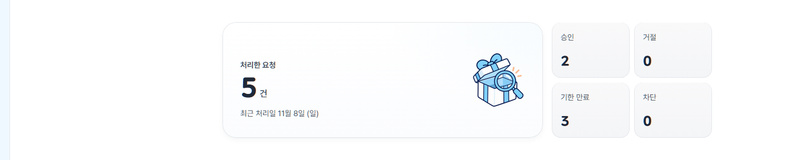</a> | <a href="compare/gray-sub-card/after__creator-requests__1440.png">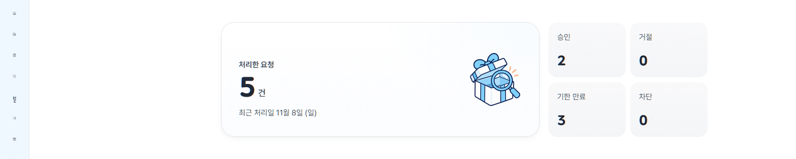</a> |
| 승인 내역 (/creator/requests) · 390 | <a href="compare/gray-sub-card/before__creator-requests__390.png">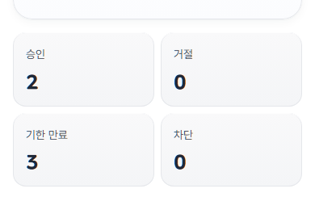</a> | <a href="compare/gray-sub-card/after__creator-requests__390.png">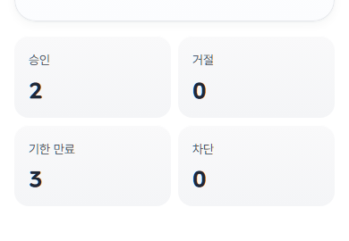</a> |
| 보낸 역조공 (/creator/revgifts) · 1440 | <a href="compare/gray-sub-card/before__creator-revgifts__1440.png">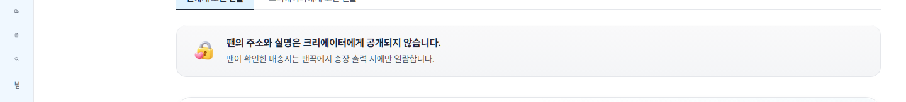</a> | <a href="compare/gray-sub-card/after__creator-revgifts__1440.png">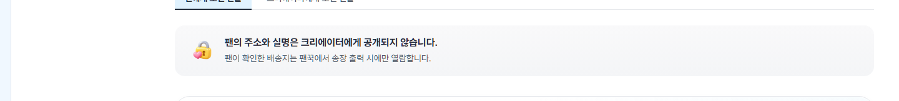</a> |
| 보낸 역조공 (/creator/revgifts) · 390 |  | <a href="compare/gray-sub-card/after__creator-revgifts__390.png">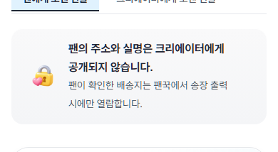</a> |

확인: 글꼴 Pretendard Variable(본문)·Tmoney Round Wind(제목) 로드 확인, 가로 넘침 0(두 화면 두 폭). 14-7 2) 누르지 않는 묶음의 테두리 없어짐 확인, 흰 바탕 위 회색 면 차이로 칸 경계가 보인다(4-8). · 시험: npx vitest run (approval-request·access-log·revgift-sent·gift-register·gift-reply·revgift-box-apply·revgift-box-manage·revgift-send·revgift-box 폴더) — 15파일 138개 통과 · 브랜치 `audit/gray-sub-card` (2883462f)

**결정**: 승인 / 고쳐서 승인 / 안 함 → 승인 (design-rules 760행 「회색 보조 칸 1px 선」도 같이 고침) (2026-11-21 사용자 「다 추천대로」)

**메모**: 

---

## 1-3. 빈 상태 모양이 화면마다 다르고 다음 행동이 없음

**무엇을**: 빈 상태가 팬 「지금 할 일」(/me/actions)과 같은 모양(흰 카드 · 가운데 그림 72 · 굵은 제목 · 한 줄 · 선 버튼 하나)으로 맞춰진다 — 받은 선물(/me/revgifts), 보낸 역조공(/creator/revgifts), 선물 현황(/creator/progress)의 받는·보내는 선물, 받은 선물(/creator/boxes). 크리에이터 홈(/creator) 「최근 열람 기록」 빈 칸에는 버튼 하나가 붙는다

**왜**: 빈 상태 모양이 화면마다 다르고(하늘 면·고양이 그림, 글만 있는 카드 등) 안내 문장만 있어 다음에 할 일이 없다 — 빈 상태에는 예시나 다음 행동을 둔다(design-prompt 9-2, 2절 가운데 정렬 묶음 8)).

**어떻게**

- 받은 선물(/me/revgifts): 하늘 면 + 오른쪽 위 고양이 그림 160 + 왼쪽 글 → 흰 카드 가운데 선물 그림 72 · 「받은 선물이 없습니다」 · 「팔로우한 크리에이터가 보낸 선물은 이곳에 표시됩니다.」 · 「크리에이터 찾기」(/creators)
- 보낸 역조공(/creator/revgifts): 흰 카드 · 그림 96 · 버튼 없음 → 그림 72 · 같은 제목과 문장 · 「팬에게 보내기」(/creator/revgift-boxes)
- 선물 현황(/creator/progress) 보내는 선물 0건: 흰 카드 안 회색 글 한 줄 → 그림 72 · 제목 「진행 중인 선물이 없습니다」 · 「팬에게 보내기」. 받는 선물 0건도 같은 모양(버튼 없음)
- 받은 선물(/creator/boxes): 흰 카드 안 글 두 문장 → 트럭 그림 72 · 「출고된 선물이 없습니다」 · 「팬꾹에서 출고하면 상자별로 표시됩니다.」 · 「선물 현황 보기」(/creator/progress)
- 크리에이터 홈 「최근 열람 기록」: 홈 요약 칸의 작은 빈 칸(아이콘 원 44 · 한 줄 · 안내) 모양은 그대로 두고 그 아래 작은 선 버튼 「보안 안내」(/security) — 팬 홈 「팔로우한 크리에이터가 없습니다」 칸의 「크리에이터 찾기」 버튼과 같은 배치
- 버튼 선은 기준 화면과 같은 짙은 선(--gray-500)

코드: 새 공용 컴포넌트 shared/ui/empty-state.tsx(EmptyState) + empty-state.module.css · my-revgifts-panel.tsx(.epanel), revgift-sent-page.tsx(.sempty), gift-progress-page.tsx(.none), received-box-list.tsx(.empty) 교체 · creator-home-page.tsx 열람 기록 EmptyCard 에 emptyAct 버튼

**같이 바뀌는 곳**

- 선물 현황 /creator/progress 「받는 선물」 0건 빈 상태도 같은 모양으로 바뀐다(다음 행동은 두지 않음 — 크리에이터가 할 수 있는 일이 없다)
- 제안(안 고침): 팬 /me/actions·크리에이터 /creator/actions 의 빈 상태는 이미 같은 모양이라 공용 컴포넌트로 옮기기만 하면 된다
- 제안(안 고침): 홈 요약 칸 빈 칸(EmptyCard — 팬 홈·크리에이터 홈·공지)은 작은 가로 모양(design-rules 35절)으로 남겼다. 한 화면에 빈 칸이 세 개 겹칠 수 있는 요약 자리라 큰 가운데 카드로 바꾸면 홈이 길어진다

**비교**

| 화면 · 폭 | 지금 | 시안 |
|---|---|---|
| 받은 선물 — 팬 (/me/revgifts) · 1440 | <a href="compare/empty-state/before__me-revgifts__1440.png">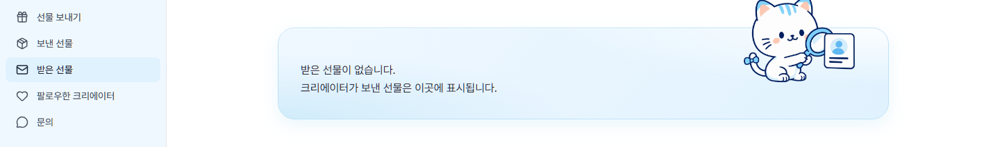</a> | <a href="compare/empty-state/after__me-revgifts__1440.png">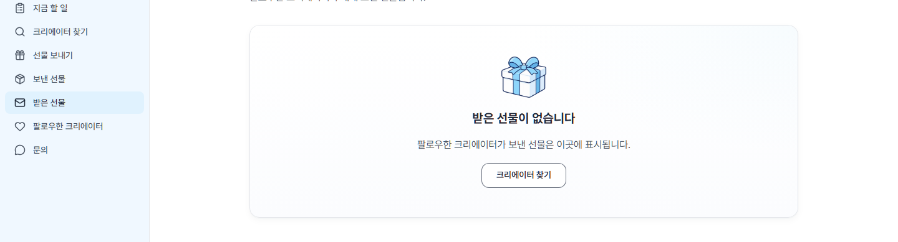</a> |
| 받은 선물 — 팬 (/me/revgifts) · 390 | <a href="compare/empty-state/before__me-revgifts__390.png">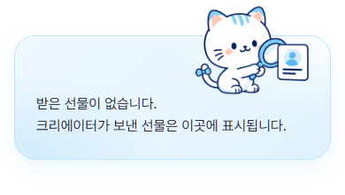</a> | <a href="compare/empty-state/after__me-revgifts__390.png">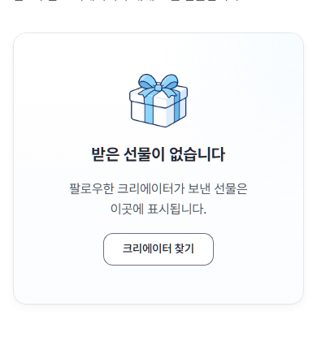</a> |
| 보낸 역조공 (/creator/revgifts) · 1440 | <a href="compare/empty-state/before__creator-revgifts__1440.png">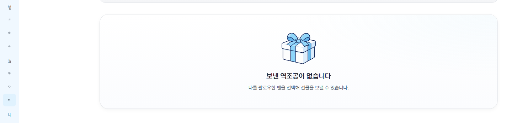</a> | <a href="compare/empty-state/after__creator-revgifts__1440.png">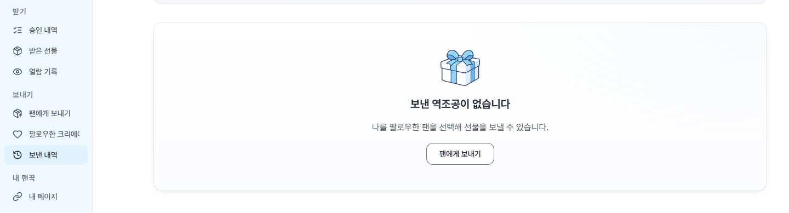</a> |
| 보낸 역조공 (/creator/revgifts) · 390 | <a href="compare/empty-state/before__creator-revgifts__390.png">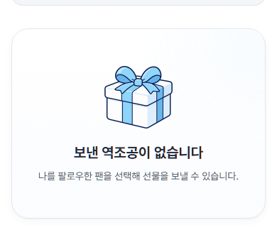</a> | <a href="compare/empty-state/after__creator-revgifts__390.png">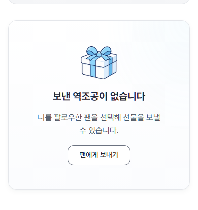</a> |
| 선물 현황 — 보내는 선물 (/creator/progress) · 1440 | <a href="compare/empty-state/before__creator-progress__1440.png">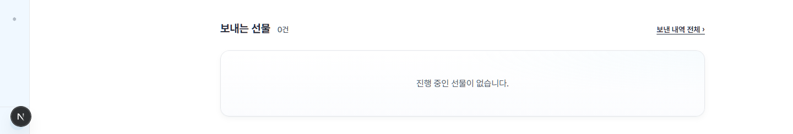</a> | <a href="compare/empty-state/after__creator-progress__1440.png">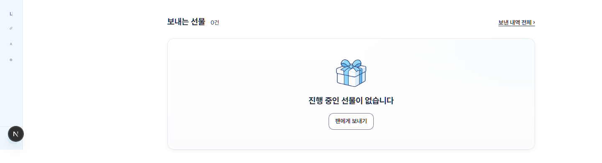</a> |
| 선물 현황 — 보내는 선물 (/creator/progress) · 390 | <a href="compare/empty-state/before__creator-progress__390.png">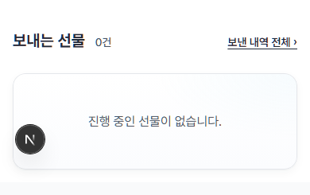</a> | <a href="compare/empty-state/after__creator-progress__390.png">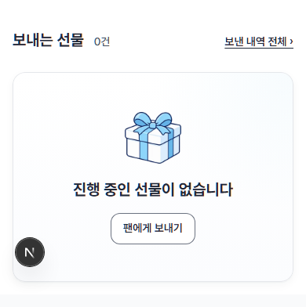</a> |
| 받은 선물 — 크리에이터 (/creator/boxes) · 1440 | <a href="compare/empty-state/before__creator-boxes__1440.png">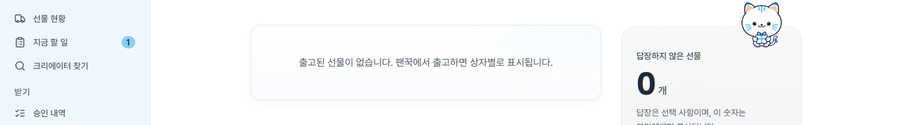</a> | <a href="compare/empty-state/after__creator-boxes__1440.png">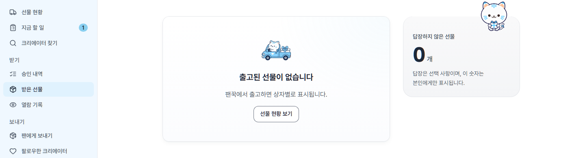</a> |
| 받은 선물 — 크리에이터 (/creator/boxes) · 390 | <a href="compare/empty-state/before__creator-boxes__390.png">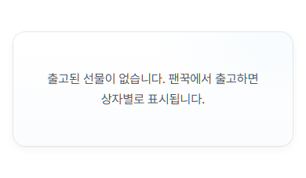</a> | <a href="compare/empty-state/after__creator-boxes__390.png">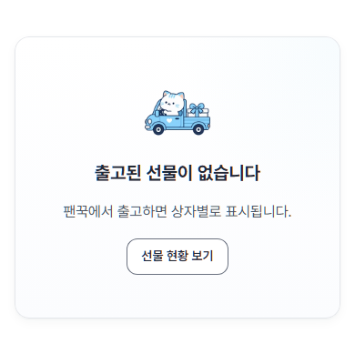</a> |
| 크리에이터 홈 — 최근 열람 기록 (/creator) · 1440 | <a href="compare/empty-state/before__creator-home__1440.png">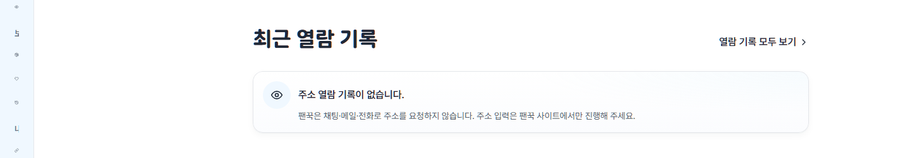</a> | <a href="compare/empty-state/after__creator-home__1440.png">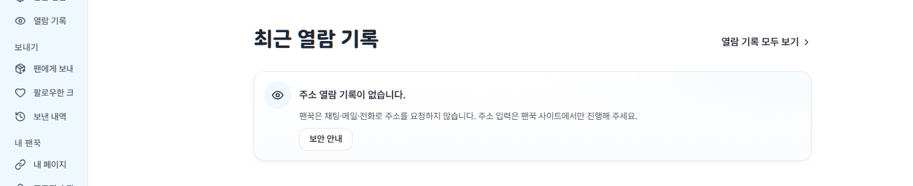</a> |
| 크리에이터 홈 — 최근 열람 기록 (/creator) · 390 | <a href="compare/empty-state/before__creator-home__390.png">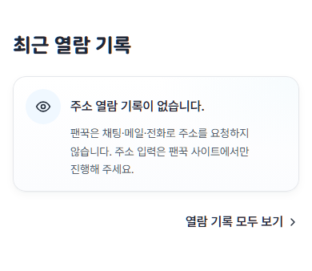</a> | <a href="compare/empty-state/after__creator-home__390.png">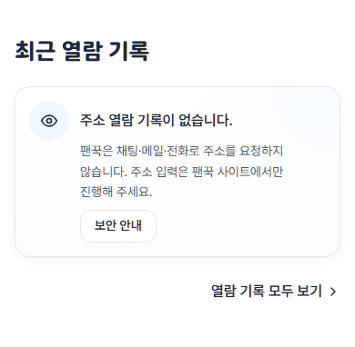</a> |

확인: 글꼴 Pretendard Variable(본문)·Tmoney Round Wind(제목) 로드, 가로 넘침 0(다섯 화면 두 폭). 14-7: 1) 그림 72·제목 20 은 기준 화면(/me/actions)과 같다(보낸 역조공 그림 96→72 로 작아짐) 2) 해당 없음 8) 시선 순서 그림 → 제목 → 버튼. 기준 그림 사본 before__me-actions-ref__*.png 를 같이 두었다. · 시험: npx vitest run src/widgets/my-revgifts src/widgets/revgift-sent src/widgets/creator-gift-progress src/features/gift-reply src/widgets/home src/shared/ui — 14파일 85개 통과(받은 선물 빈 상태 시험을 제목·버튼 확인으로 고침) · npx tsc --noEmit 오류 0 · npm run copy:lint 금지어 0 · 브랜치 `audit/empty-state` (069377d8)

**결정**: 승인 / 고쳐서 승인 / 안 함 → 승인 (홈 최근 열람은 작은 모양 유지, 선물 현황 받는 선물은 버튼 없음 — 시안대로) (2026-11-21 사용자 「다 추천대로」)

**메모**: 

---

## 1-4. 휴대폰 저장 줄의 「취소/저장」이 반씩 나란히

**무엇을**: 휴대폰(767 이하)에서 크리에이터 설정 판 아래 저장 줄 — 프로필 수정(/creator/profile) 소개 판의 「취소/저장」, 꾸미기(/creator/profile?tab=channel) 판의 「취소/저장」과 팬덤 판의 「되돌리기/저장」 — 이 「저장」 폭 전체 + 그 아래 글자 버튼으로 바뀐다. PC 배치는 그대로

**왜**: 휴대폰에서 주 버튼과 보조 버튼이 반씩 나란히 놓여 폼의 휴대폰 배치와 다르다 — 폼 휴대폰은 주 버튼 폭 전체, 보조는 그 아래 글자 버튼(design-prompt 2-21 2), 8-1).

**어떻게**

- 휴대폰 버튼 배치: [취소][저장] 한 줄에 반씩 → 「저장」 한 줄 폭 전체, 그 아래 「취소」(또는 「되돌리기」) 한 줄
- 보조 버튼 모양: 흰 면 + 짙은 선 → 선·면 없는 글자 버튼(누르는 칸 높이 44 유지, 누르면 옅은 회색 면)
- 버튼 하나만 있는 저장 줄(생일·기념일 저장)은 휴대폰에서 폭 전체로 — 지금과 같음
- PC(768 이상): [보조][주] 오른쪽 정렬 그대로

코드: src/shared/ui/settings-panel.module.css 휴대폰 미디어 쿼리의 .barBtns(column-reverse, 폭 전체) · .bar .barBtns.barBtns > .btn--line(글자 버튼 모양)

**같이 바뀌는 곳**

- 꾸미기 /creator/profile?tab=channel 의 팬덤 판 「되돌리기/저장」 줄
- 프로필 수정 /creator/profile 의 「생일·기념일 저장」 줄(버튼 하나 — 모양 변화 없음)
- 계정 설정 /creator/account·설정 /creator/settings 의 공용 저장 줄을 쓰는 판(같은 CSS)
- /creator/customize 는 /creator/profile 로 넘기는 옛 주소라 따로 바뀌는 화면이 없다
- 휴대폰 저장 줄은 판 아래에 붙어 따라오는 고정 줄이라 두 줄로 쌓이면서 높이가 약 50px 늘어난다

**비교**

| 화면 · 폭 | 지금 | 시안 |
|---|---|---|
| 프로필 수정 — 소개 판 (/creator/profile) · 390 | <a href="compare/section-save-bar/before__creator-profile__390.png">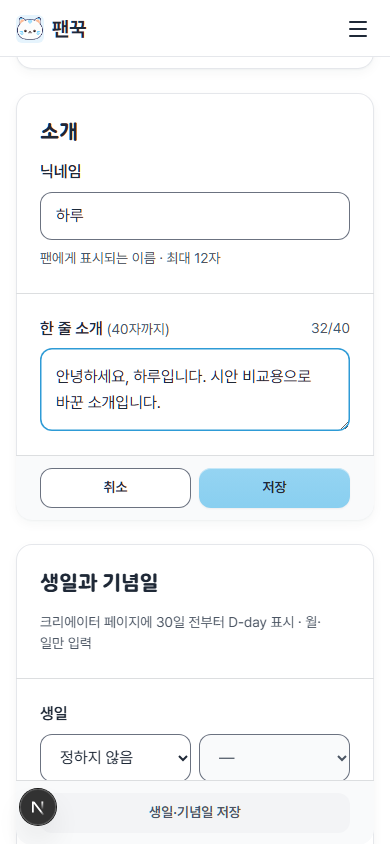</a> | <a href="compare/section-save-bar/after__creator-profile__390.png">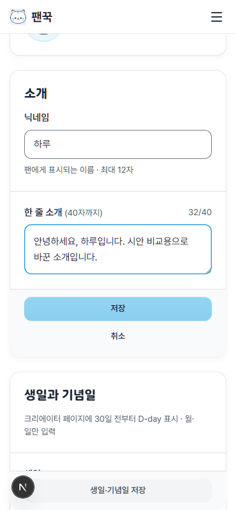</a> |
| 프로필 수정 — 소개 판 (/creator/profile) · 1440 | <a href="compare/section-save-bar/before__creator-profile__1440.png">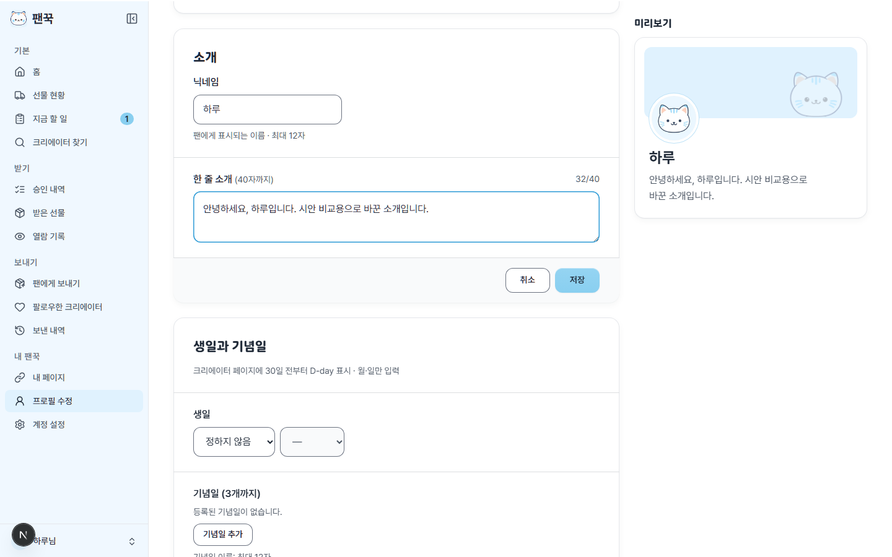</a> | <a href="compare/section-save-bar/after__creator-profile__1440.png">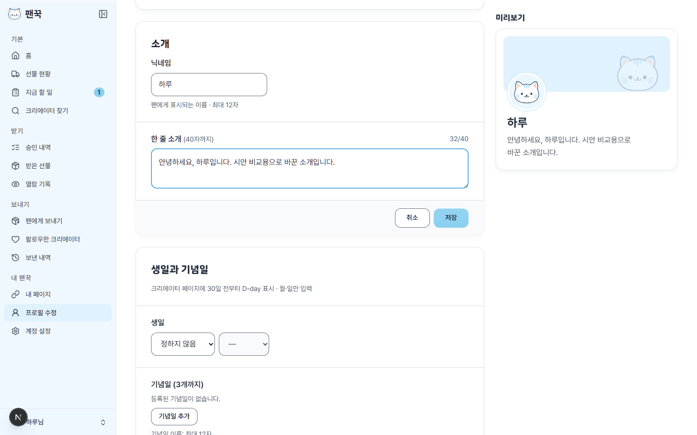</a> |
| 꾸미기 (/creator/profile?tab=channel) · 390 | <a href="compare/section-save-bar/before__creator-profile-channel__390.png">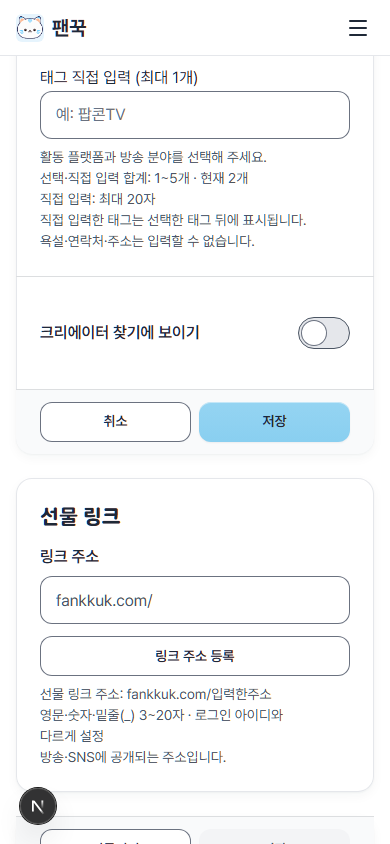</a> | <a href="compare/section-save-bar/after__creator-profile-channel__390.png">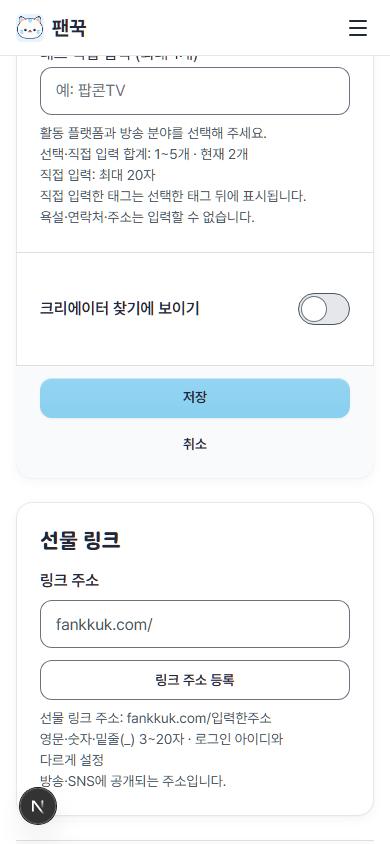</a> |
| 꾸미기 (/creator/profile?tab=channel) · 1440 | <a href="compare/section-save-bar/before__creator-profile-channel__1440.png">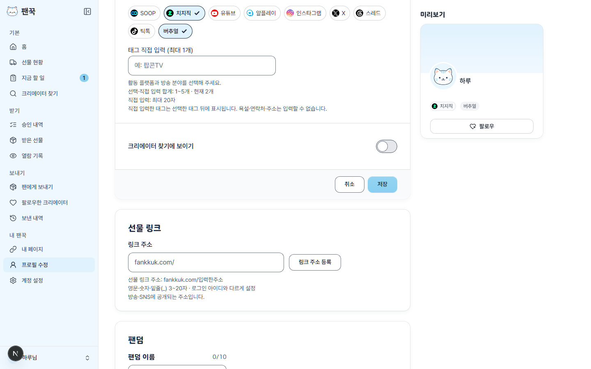</a> |  |

확인: 글꼴 Pretendard Variable·Tmoney Round Wind 로드, 가로 넘침 0(두 화면 두 폭). 저장 줄을 띄우려고 소개 글을 바꾸거나 「크리에이터 찾기에 보이기」를 눌렀고 저장은 누르지 않았다. 14-7 3) 한 줄 칸 크기 차이 없어짐, 8) 시선 「저장」이 먼저. 화면마다 선 버튼을 짙은 선으로 덮는 규칙이 처음에 이겨 「취소」에 선이 남았던 것을 고쳐 다시 찍었다. · 시험: npx vitest run src/widgets/creator-profile-edit src/widgets/creator-settings src/shared/ui — 12파일 88개 통과 · 브랜치 `audit/section-save-bar` (febf9a67)

**결정**: 승인 / 고쳐서 승인 / 안 함 → 승인 (2026-11-21 사용자 「다 추천대로」)

**메모**: 

---

## 1-5. 크리에이터 카드 줄 위치가 소개·뱃지 유무로 달라짐

**무엇을**: 크리에이터 찾기(/creators)와 팬 홈(/home) 등 크리에이터 카드에서, 소개 글이 없거나 팬덤 뱃지가 없어도 그 줄 자리가 비어 남아, 플랫폼 칩 줄과 버튼 줄이 모든 카드에서 같은 높이에 놓이고 카드 높이도 같아진다.

**왜**: 소개가 없는 카드(하루·ㅈㅈ)만 칩 줄이 29 위로 올라갔고, 휴대폰 한 열에서는 뱃지·소개 유무에 따라 카드 높이가 232·250·261로 달랐다 — design-prompt 8-8(내용 양이 달라도 아래 정보 위치는 고정).

**어떻게**

- 소개 줄: 비면 접고 한 줄이면 한 줄만 차지 → 소개가 없어도 두 줄(42) 자리를 늘 남김(넘치면 둘째 줄 끝 말줄임은 그대로)
- 팬덤 뱃지 줄: 찾기 화면이 한 열(휴대폰)일 때 비면 접던 것 → 어느 폭에서도 22 자리를 남김(여러 열에서는 원래 남기고 있었다)
- 칩 줄 위치(카드 위에서, 1440): 소개 없는 카드 181 · 나머지 210 → 모두 231
- 칩 줄 위치(찾기 390): 142 · 160 · 171 → 모두 210. 팬 홈 390: 167 · 196 → 모두 217
- 카드 높이: 찾기·팬 홈 1440 300 → 321(전부 같음, +21) · 찾기 390 232/250/261 → 모두 300 · 팬 홈 390 286 → 307
- 대가: 카드가 21~68 커지고, 소개가 없는 카드는 이름 아래에 약 70의 빈칸이 생긴다(after__fan-home 캡처의 「하루」). 11-13에 「짧은 소개 카드에 빈칸이 크게 남지 않게」 접기로 한 결정을 되돌리는 것이라 design-rules 17절 11-13 블록과 부딪힌다 — 승인되면 그 줄을 고쳐야 한다

코드: src/entities/creator/ui/creator-card-head.module.css(.line:empty 접기 삭제 + .line height 2줄 고정, [data-card-stack] .badgeRow:empty 접기 삭제) · creator-card-head.tsx(주석만)

**같이 바뀌는 곳**

- 로그인 전 첫 화면(/)의 새 크리에이터 카드 줄 — 같은 카드 부품(캡처 없음)
- 크리에이터 프로필 수정 화면(/creator/profile)의 카드 미리보기 — 같은 부품이라 소개를 비우면 빈 두 줄 자리가 보인다(캡처 없음)
- 팔로우한 크리에이터 목록 줄은 소개 글자 함수만 같이 쓰고 이 CSS 를 쓰지 않아 바뀌지 않는다
- 문서: design-rules 17절 「소개는 내용만큼(최대 두 줄)」(11-13) 줄, 한 열에서 빈 뱃지 줄을 접는다는 줄(승인 뒤)

**심사 화면에서 달라지는 점**: 심사 화면인 크리에이터 찾기(/creators)의 카드 모양이 바뀐다 — 카드가 조금 커지고(1440 +21) 칩·버튼 줄이 카드마다 같은 높이. 문구·요금·정보는 바뀌지 않는다.

**비교**

| 화면 · 폭 | 지금 | 시안 |
|---|---|---|
| 크리에이터 찾기 (/creators) · 1440 | <a href="compare/creator-card/before__creators__1440.png">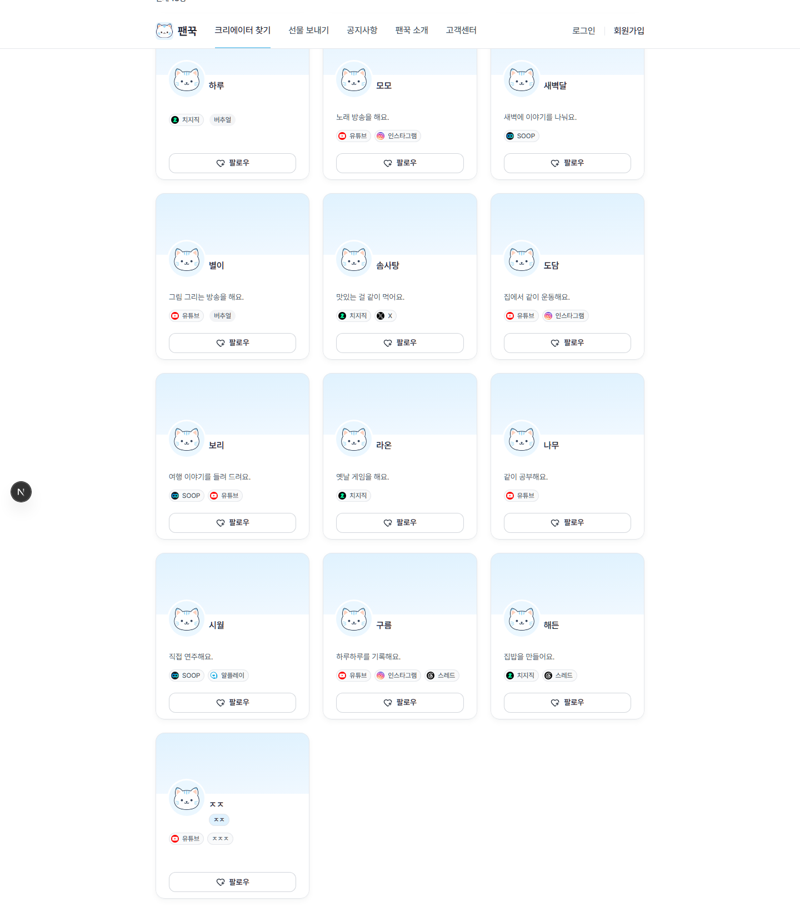</a> | <a href="compare/creator-card/after__creators__1440.png">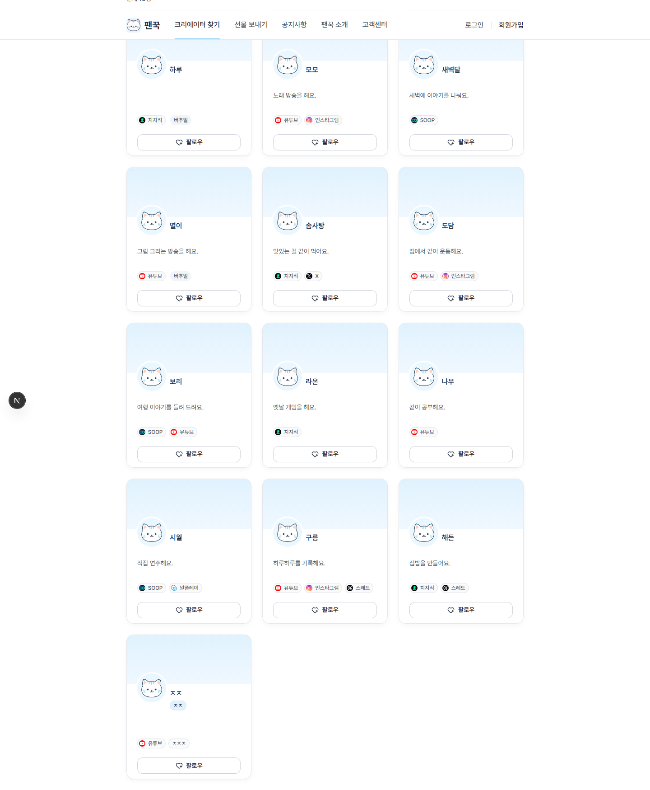</a> |
| 크리에이터 찾기 (/creators) · 390 | <a href="compare/creator-card/before__creators__390.png">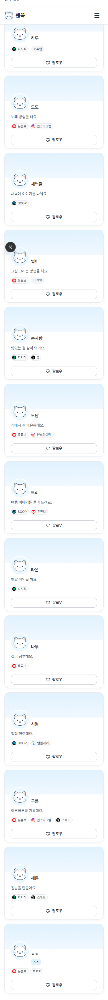</a> | <a href="compare/creator-card/after__creators__390.png">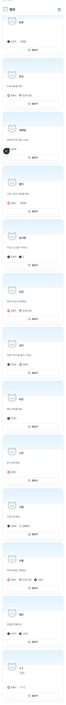</a> |
| 팬 홈 — 팔로우한 크리에이터 줄 (/home, 팬 로그인) · 1440 | <a href="compare/creator-card/before__fan-home__1440.png">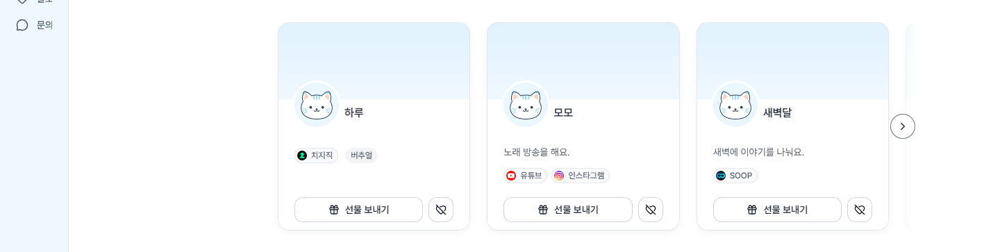</a> | <a href="compare/creator-card/after__fan-home__1440.png">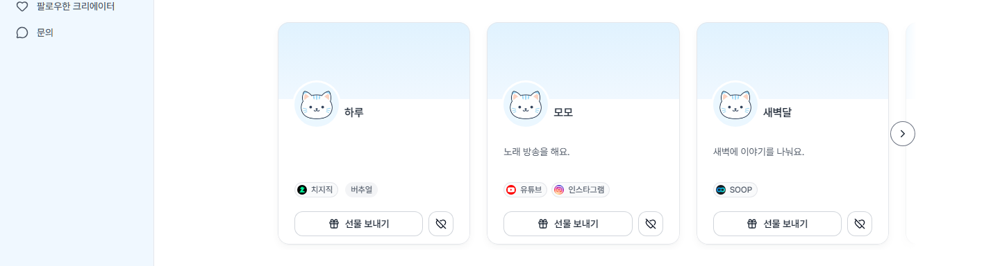</a> |
| 팬 홈 — 팔로우한 크리에이터 줄 (/home, 팬 로그인) · 390 | <a href="compare/creator-card/before__fan-home__390.png">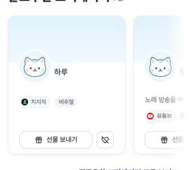</a> | <a href="compare/creator-card/after__fan-home__390.png">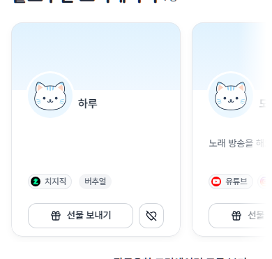</a> |

확인: document.fonts 에 Pretendard Variable·Tmoney Round Wind 로드, 가로 넘침 1440·390 모두 0. 14-7 3) 한 줄 카드들의 칩·버튼 위치와 카드 높이가 13장 모두 같음(실측). 1) 카드가 이전보다 21 이상 커졌다 — 위 「대가」에 적었다. · 시험: npx vitest run src/entities/creator/ui src/widgets/creator-search src/widgets/creator-settings/ui/fandom-section.test.tsx — 4파일 54개 통과 · 브랜치 `audit/creator-card` (b9933875)

**결정**: 승인 / 고쳐서 승인 / 안 함 → 승인 (소개 없는 카드의 빈칸 대가 수용, design-rules 17절 11-13 줄 고침) (2026-11-21 사용자 「다 추천대로」)

**메모**: 

---

## 1-6. 크리에이터 상세 머리의 요금 줄이 팔로우 버튼과 떨어짐

**무엇을**: 크리에이터 상세(/creators/[id])와 개인 주소 페이지(/[handle]) 머리에서 「요금 6,900원부터 · 평균 승인 소요 시간」 줄이 팔로우(또는 선물 보내기·팔로우 중) 버튼 바로 아래 8 간격으로 붙고, 버튼과 요금 줄이 둘 다 본문 칸 오른쪽 끝에 맞춰진다.

**왜**: 선물함이 없으면 요금 줄이 버튼에서 126 떨어진 아랫줄 오른쪽에 혼자 놓였고, 버튼 오른쪽 끝(1023)과 요금 줄 오른쪽 끝(1200)도 달랐다 — design-prompt 8-16(망설이는 버튼 바로 아래나 옆에 요금 한 줄) · 14-7 5)(함께 읽을 정보가 떨어져 있지 않은가).

**어떻게**

- 요금 줄 위치(1440, 로그인 전): 버튼 아래 126 떨어진 아랫줄(y 766) → 버튼 바로 아래 8(y 648)
- 오른쪽 끝(1440): 버튼 1023 · 요금 줄 약 1200 → 둘 다 1260(본문 칸 오른쪽 끝). 팬 로그인 화면도 버튼·요금 줄 모두 1380으로 같다
- 버튼 위치(1440): 오른쪽 칸 왼쪽(911)에서 시작 → 오른쪽 칸 오른쪽 끝에 붙임
- 머리 전체 높이(1440): 204 → 150 (빈 아랫줄과 그 위 간격 32가 사라짐)
- 휴대폰(390): 버튼 아래 48 떨어져 있던 요금 줄 → 버튼 바로 아래 8. 왼쪽 정렬은 그대로
- 받기 어려운 선물 안내 상자도 요금 줄을 따라 버튼 아래로 온다
- 선물함이 있을 때: 선물함은 아랫줄 왼쪽 그대로, 요금 줄은 버튼 아래(오른쪽 칸이 두 줄에 걸침). 휴대폰 순서는 프로필 → 버튼 → 요금 → 선물함으로 바뀐다(전에는 선물함이 버튼과 요금 사이). 시험 데이터에 공개 선물함이 있는 공개 크리에이터가 없어 이 경우는 캡처하지 못했다 — 선물함 있는 두 크리에이터는 둘 다 공개 전이라 상세가 404
- design-rules 44절 「아랫줄 선물함 | 요금·승인 시간」·「휴대폰 한 열: 프로필 → 버튼 → 선물함 → 요금」과 부딪힌다 — 승인되면 44절 두 줄을 고쳐야 한다(이 브랜치에서는 문서를 고치지 않았다)

코드: src/widgets/creator-profile/ui/creator-profile-page.tsx(.sendMeta 를 .actions 안으로) · creator-profile.module.css(.head 영역 "id act" "boxes act", 선물함 없으면 "id act" 한 줄(:has), .actions 세로 flex 오른쪽 정렬, 879 이하는 왼쪽 정렬)

**같이 바뀌는 곳**

- 개인 주소 페이지 /wikdhdl — 같은 화면 부품(캡처 있음)
- 팬 로그인 화면(선물 보내기 + 팔로우 중) — 같은 정렬(after__creator-detail-fan__1440·390, 바꾸기 전 캡처 없음)
- 채널 확인 중인 크리에이터 상세(verifying-creator-page) — 같은 버튼 칸을 써서 「채널 확인이 끝나면…」 안내 상자가 오른쪽 칸 왼쪽에서 오른쪽 끝으로 옮겨진다(캡처 없음, 시험 데이터 없음)
- 크리에이터 본인 화면의 「내 페이지」 꼬리표·쉬는 중 한 줄도 오른쪽 끝 정렬로 바뀐다
- 문서: design-rules 44절 상단 묶음 줄, docs/ux/pages/handle.md 의 머리 배치 줄(승인 뒤)

**비교**

| 화면 · 폭 | 지금 | 시안 |
|---|---|---|
| 크리에이터 상세 (/creators/00000000-0000-4000-b000-000000000001) · 1440 |  |  |
| 크리에이터 상세 (/creators/00000000-0000-4000-b000-000000000001) · 390 |  |  |
| 개인 주소 페이지 (/wikdhdl) · 1440 |  |  |
| 개인 주소 페이지 (/wikdhdl) · 390 |  |  |
| 크리에이터 상세 — 팬 로그인 (/creators/00000000-0000-4000-b000-000000000001) · 1440 | — |  |

확인: document.fonts 에 Pretendard Variable·Tmoney Round Wind 로드, 가로 넘침 1440·390(로그인 전·팬) 모두 0. 14-7 5) 요금이 버튼에 붙었고 3) 버튼·요금 오른쪽 끝이 같다. 8) 시선 1번은 이름(제목) 그대로 — 고칠 것 없음. · 시험: npx vitest run tests/creator-detail-e-ui.test.tsx tests/channel-badge-ui.test.tsx tests/creator-colors-ui.test.tsx tests/follow-notice-ui.test.tsx tests/profile-single-send-ui.test.tsx tests/profile-unsigned-ui.test.tsx — 6파일 67개 통과 · 브랜치 `audit/creator-profile-head` (55476cb2)

**결정**: 승인 / 고쳐서 승인 / 안 함 → 승인 (2026-11-21 사용자 「다 추천대로」)

**메모**: 

---

## 1-7. 소개 배너 그림 속 글자가 휴대폰에서 6~7px

**무엇을**: 로그인 전 첫 화면(/)과 회원 배너 첫 장(크리에이터 홈 /creator · 팬 홈 /home · 로그인 후 크리에이터 찾기 /creators)의 소개 배너 「팬의 마음을, 크리에이터에게.」 — 글자가 그림 안에 박혀 있어 휴대폰에서 작아진다.

**왜**: 그림 폭 2172 를 화면 폭에 맞춰 줄이므로 390 에서 배너가 358×119 가 되고, 그림 속 작은 문장 「승인한 선물을 검수해 전달해요.」가 약 6.6px, 큰 제목도 약 16.5px 로 줄어든다(1440 에서는 각각 약 16px·40px) — design-prompt 토큰 「보조 글자만 12」 하한 미달.

**어떻게**

- public 에서 쓸 수 있는 그림을 찾았다: banners 폴더 13장(launch-01~03 의 원본·no-button·v2·v3, gift-delivery-banner v1·v2, gift-cat-v1), home·about 폴더. 소개 배너와 같은 그림의 글자 없는 판은 없다. gift-delivery-banner 두 장은 다른 문구가 박혀 있고, gift-cat-v1 은 배경 없는 고양이 한 마리(정사각)라 배너 그림으로는 모양이 다르다
- 안 1 — 휴대폰용 그림: 같은 그림을 휴대폰 비율(예: 4:3 또는 1:1)로 다시 만들어 글자를 크게 넣고, 768 이하에서 <picture> 로 바꿔 낸다. 장점: 지금 모양 그대로. 단점: 글자를 고치면 그림을 두 장 다시 만들어야 하고, 낭독기는 여전히 alt 만 읽는다
- 안 2(추천) — 글자 없는 그림 + HTML 글: 지금 그림에서 글자만 뺀 판(왼쪽 옅은 면 + 오른쪽 고양이·상자)을 새로 만들고, 제목·설명을 HTML 글로 얹는다. 휴대폰에서 글자가 20/14 같은 토큰 크기로 보이고, 문구를 코드에서 고칠 수 있다. 단점: 그림 한 장 필요, 회원 배너 넘김(광고 배너와 같은 칸)에서 이 장만 글 층을 그리는 처리가 필요
- 그림 없이 해 볼 수 있는 임시 안(만들지 않았다): 지금 그림의 오른쪽(가로 약 820 이후 — 고양이·상자, 글자 없음)만 잘라 보이고 글자는 HTML 로 위나 옆에 둔다. 새 그림은 필요 없지만 잘린 그림 왼쪽 끝에 파란 사선 면이 걸쳐 어색할 수 있어 시안으로 먼저 확인해야 한다

코드: (바꾸지 않음) 그림은 src/entities/banner/model/intro-banner.ts 의 imageUrl 과 src/widgets/home/ui/front-slots.tsx GuestIntroBanner 가 같은 파일 /images/banners/launch-01-introduction-no-button.png 를 쓴다. 회원 배너는 src/widgets/banner-carousel/ui/banner-slot.tsx memberBannerSlot

**같이 바뀌는 곳**

- 회원 배너 첫 장은 크리에이터 홈(/creator)·팬 홈(/home)·로그인 후 크리에이터 찾기(/creators) 세 화면에 같이 나온다
- 로그인 전 크리에이터 찾기(/creators)는 회원 배너가 아니라 광고 배너 줄(bannerSlot)이라 소개 그림이 나오지 않는다

**심사 화면에서 달라지는 점**: 심사 화면 중 로그인 전 첫 화면(/)의 소개 배너가 바뀔 화면이다(이번에는 코드를 바꾸지 않아 달라진 점 없음).

**비교**

| 화면 · 폭 | 지금 | 시안 |
|---|---|---|
| 로그인 전 첫 화면 (/) · 1440 |  | — |
| 로그인 전 첫 화면 (/) · 390 |  | — |
| 크리에이터 홈 (/creator, 크리에이터 로그인) · 1440 |  | — |
| 크리에이터 홈 (/creator, 크리에이터 로그인) · 390 |  | — |

확인: 바꾸기 전 화면만 확인: 글꼴 Pretendard Variable·Tmoney Round Wind 로드, 가로 넘침 0. 390 에서 그림 속 작은 문장이 약 6.6px(그림 폭 비율로 계산) — 12 하한 미달 확인. · 시험: 코드 변경 없음 — 시험 돌리지 않음 · 브랜치 `` ()

**결정**: 승인 / 고쳐서 승인 / 안 함 → 승인 안 2 — 글자 없는 그림 + HTML 글. 그림 새로 필요(그림이 오기 전까지 구현 대기) (2026-11-21 사용자 「다 추천대로」)

**메모**: 

---

## 1-8. 문서 화면에 검색이 두 개(검색칸 + 「찾기」)

**무엇을**: 문서형 화면(요금 안내 /pricing, 팬 이용 안내 /guide/fan 등) 본문 위에 붙는 목차 줄. 검색칸이 화면에 보이는 동안에는 줄의 「찾기」 단추가 사라지고, 지금 읽는 조의 제목이 줄 바로 아래 보이는 동안에는 줄 왼쪽의 조 이름이 감춰진다.

**왜**: 검색칸과 「찾기」가 한 화면에 함께 보여 같은 일을 하는 수단이 둘이고, 줄의 조 이름이 바로 아래 구역 제목과 같은 글자로 반복된다 (design-prompt 1-3 · 9-4 · 13-1).

**어떻게**

- 페이지 맨 위(검색칸이 보임): 줄에 「상자 요금 · 찾기 · 목차 열기」 → 「목차 열기」만
- 검색칸이 화면 위로 지나간 뒤: 「찾기」가 다시 나타난다(누르면 지금처럼 검색칸으로 올라가 입력 준비)
- 조 이름: 그 조 제목이 줄 바로 아래(화면 높이 1/3 안)에 보이면 감추고, 제목이 줄 위로 지나가면 다시 보인다. 감춰도 자리는 남아 「찾기」·「목차 열기」 위치는 움직이지 않는다
- 줄 높이 44, 옆 목차가 보이는 넓은 화면(안내 글 다섯·자주 묻는 질문 1376 이상)에서 줄을 숨기는 동작은 그대로

코드: src/widgets/legal/ui/doc-toc-bar.tsx DocTocBar(searchRef 추가, 스크롤 시 검색칸·지금 조 제목 위치 확인) · doc-page.module.css .barNowQuiet · doc-page.tsx/faq-page.tsx 에서 searchRef 전달

**같이 바뀌는 곳**

- 가이드 크리에이터 /guide/creator
- 검수 안내 /inspection
- 보안 /security
- 분쟁 /dispute
- 개인정보처리방침 /privacy
- 이용약관 /terms
- 환불 규정 /refund
- 자주 묻는 질문 /faq — 모두 같은 목차 줄을 써서 같이 바뀐다(안내 글 다섯·자주 묻는 질문은 넓은 화면에서 줄 자체가 숨어 있어 좁은 화면에서만 차이가 보인다)

**심사 화면에서 달라지는 점**: 요금 안내·이용약관·개인정보처리방침·환불 규정의 첫 화면에서 검색칸 아래 줄이 「목차 열기」 하나만 남는다. 심사 캡처에서 검색 수단이 둘로 보이던 것이 사라진다. 본문·문구는 바뀌지 않는다.

**비교**

| 화면 · 폭 | 지금 | 시안 |
|---|---|---|
| 요금 안내 (/pricing) · 1440 |  |  |
| 요금 안내 (/pricing) · 390 |  |  |
| 팬 이용 안내 (/guide/fan) · 1440 |  |  |
| 팬 이용 안내 (/guide/fan) · 390 |  |  |

확인: document.fonts: Pretendard Variable·Tmoney Round Wind 로드됨, 가로 넘침 0(1440·390). 스크롤한 상태에서 「찾기」 다시 보임·조 이름은 제목이 지나간 뒤 보임 확인(/pricing 1440 scroll 1400, /guide/fan 390 scroll 2200). 팬 이용 안내 1440 은 옆 목차가 있어 원래 줄이 없으므로 전후 같음. · 시험: npx vitest run src/widgets/legal → 5 files, 99 passed (변경 전). 새 시험 1개 추가 후 doc-page.test.tsx 41 passed; 옛 doc-toc-bar.tsx 로 되돌리면 새 시험 1 failed 로 잡히는 것 확인 · 브랜치 `audit/policy-doc-toolbar` (201e5f56)

**결정**: 승인 / 고쳐서 승인 / 안 함 → 승인 (2026-11-21 사용자 「다 추천대로」)

**메모**: 

---

## 1-9. 「주요 내용」 판의 화살표가 판 끝이 아니라 글 끝에 붙음

**무엇을**: 이용약관(/terms)·개인정보처리방침(/privacy)·환불 규정(/refund) 머리의 「주요 내용」 판. 줄마다 붙은 「>」 화살표가 글 끝이 아니라 판 안쪽 오른쪽 끝에 선다.

**왜**: 화살표가 판 안쪽 오른쪽 끝(1128)이 아니라 글 폭 끝(약 992)에 있어 판 오른쪽 약 136이 비고, 줄 안 동작은 줄 오른쪽 끝에 둔다는 규칙과 다르다 (design-prompt 2-21의 11 · 2-9).

**어떻게**

- 화살표 위치(1440 폭): 왼쪽 972~992 → 1108~1128(판 안쪽 오른쪽 끝, 판 안쪽 여백 32)
- 누르는 칸(줄): 글 폭 680 → 판 안쪽 폭 전체 816. 마우스를 올렸을 때 흰 면도 판 폭 전체로 깔린다
- 글 폭·줄바꿈 위치: 바뀌지 않음(약 608 그대로)
- 390 폭: 원래도 판 폭이 680보다 좁아 화살표가 판 끝(338)에 있었음 — 바뀌지 않음
- 요금 안내(/pricing)의 「핵심 안내」 판은 줄에 갈 곳이 없어 화살표가 없다 — 화면 차이 없음(캡처는 전후 같음)

코드: src/widgets/legal/ui/doc-page.module.css — .summaryList max-width 제거, .summaryText 에 글 폭 상한, .summaryGo margin-left:auto

**같이 바뀌는 곳**

- 개인정보처리방침 /privacy
- 환불 규정 /refund — 같은 판이라 같이 바뀜

**심사 화면에서 달라지는 점**: 이용약관·개인정보처리방침·환불 규정 첫 화면의 「주요 내용」 판에서 화살표가 판 오른쪽 끝으로 옮겨진다. 문구·줄바꿈은 같다. 요금 안내는 달라지는 점 없음.

**비교**

| 화면 · 폭 | 지금 | 시안 |
|---|---|---|
| 이용약관 (/terms) · 1440 |  |  |
| 이용약관 (/terms) · 390 |  |  |
| 요금 안내 (/pricing) · 1440 |  |  |
| 요금 안내 (/pricing) · 390 |  |  |

확인: document.fonts: Pretendard Variable·Tmoney Round Wind 로드됨, 가로 넘침 0(1440·390). 화살표 x 1108(판 안쪽 끝 1128 − 20) 실측, 세 줄 모두 같은 세로선. · 시험: npx vitest run src/widgets/legal → 5 files, 99 passed · 브랜치 `audit/policy-summary-panel` (a7431545)

**결정**: 승인 / 고쳐서 승인 / 안 함 → 승인 (2026-11-21 사용자 「다 추천대로」)

**메모**: 

---

## 1-10. 문서 검색칸 폭(680)이 위아래 판(880)과 다름

**무엇을**: 자주 묻는 질문(/faq)과 안내 글 다섯(팬 이용 안내 /guide/fan 등)의 「문서 내 검색」 칸. 오른쪽 끝이 위 「핵심 안내」 판·아래 질문 목록(또는 본문 묶음)의 오른쪽 끝과 맞는다.

**왜**: 검색칸만 폭 680이고 위아래 판은 880이라 검색칸 오른쪽 끝만 200 안쪽에서 끝난다 (design-prompt 2-9 정렬선 하나 · 6-5).

**어떻게**

- 검색칸 폭(1440 폭): 680(x 280~960) → 880(x 280~1160), 위 판·아래 목록과 같음
- 390 폭: 원래도 셋 다 358 — 바뀌지 않음
- 검색 중 「이전」「다음」 단추가 붙으면 검색칸이 그만큼 줄어 한 줄에 함께 들어간다(전과 같은 방식)
- 약관 셋·요금 안내는 본문이 680이라 검색칸 680 그대로

코드: src/widgets/legal/ui/doc-page.module.css — .withSide .searchBox { max-width: none }

**같이 바뀌는 곳**

- 팬 이용 안내 /guide/fan — 1440에서 검색칸 680 · 판 880 어긋남 실측, 고친 뒤 880
- 크리에이터 이용 안내 /guide/creator — 같은 어긋남 실측, 고친 뒤 880
- 검수 안내 /inspection — 같은 어긋남 실측, 고친 뒤 880
- 보안 /security — 같은 어긋남 실측, 고친 뒤 880
- 분쟁 /dispute — 같은 어긋남 실측, 고친 뒤 880

**비교**

| 화면 · 폭 | 지금 | 시안 |
|---|---|---|
| 자주 묻는 질문 (/faq) · 1440 |  |  |
| 자주 묻는 질문 (/faq) · 390 |  |  |
| 팬 이용 안내 (/guide/fan) · 1440 |  |  |
| 팬 이용 안내 (/guide/fan) · 390 |  |  |

확인: document.fonts: Pretendard Variable·Tmoney Round Wind 로드됨, 가로 넘침 0(여섯 화면 1440 · 두 화면 390). 판·검색칸·목록 x 280 / 폭 880 세 값 일치 실측. · 시험: npx vitest run src/widgets/legal → 5 files, 99 passed · 브랜치 `audit/doc-search-width` (972631c0)

**결정**: 승인 / 고쳐서 승인 / 안 함 → 승인 (2026-11-21 사용자 「다 추천대로」)

**메모**: 

---

## 1-11. 로그인·가입 아래 「회원가입」「로그인」 링크 높이 19

**무엇을**: 로그인(/login) 카드 아래 「아직 회원이 아니신가요? 회원가입」의 「회원가입」, 가입(/signup) 아래 「이미 회원이신가요? 로그인」의 「로그인」 링크. 글자·굵기·밑줄은 같고, 누를 수 있는 세로 범위가 44가 된다.

**왜**: 두 링크의 누르는 칸 높이가 19로 44 미만이다 (design-prompt 8-12).

**어떻게**

- 링크 높이(실측, 1440·390 같음): 로그인 「회원가입」 19 → 44 · 가입 「로그인」 19 → 44
- 실제로 눌리는 세로 범위(링크 가운데에서 위아래로 짚어 본 값): 20 → 44
- 줄 높이가 44로 커져 로그인 화면의 이 줄이 약 10 아래로 내려간다(「비밀번호를 잊으셨나요?」 칸 바로 아래에 붙음, 사이 3 → 0). 가입 화면은 위 단추와 사이 27 → 24
- 보이지 않는 덧칸으로 위아래만 넓히는 방법은 쓰지 않았다 — 로그인 화면에서 바로 위 「비밀번호를 잊으셨나요?」(누르는 칸 44)와 약 10이 겹쳐 그 링크 아래쪽을 누르면 가입으로 가게 된다

코드: src/shared/ui/base.css — .foot-line a { display:inline-flex; align-items:center; min-height:var(--hit); vertical-align:middle }

**같이 바뀌는 곳**

- 전역 .foot-line 을 쓰는 곳은 로그인·가입 두 화면뿐(코드 검색 확인) — 다른 화면 변화 없음

**심사 화면에서 달라지는 점**: 로그인·가입 화면 아래 「회원가입」「로그인」 줄이 약 10 아래로 내려간다(로그인). 글자·색·밑줄은 같다. 심사 캡처의 모양 차이는 그 위치뿐이다.

**비교**

| 화면 · 폭 | 지금 | 시안 |
|---|---|---|
| 로그인 (/login) · 1440 |  |  |
| 로그인 (/login) · 390 |  |  |
| 회원가입 (/signup) · 1440 |  |  |
| 회원가입 (/signup) · 390 |  |  |

확인: document.fonts: Pretendard Variable·Tmoney Round Wind 로드됨, 가로 넘침 0(두 화면 1440·390). 캡처에서 「회원가입」과 앞 문장 글자 기준선이 맞고 밑줄 그대로 확인. · 시험: npx vitest run src/widgets/login src/widgets/signup tests/login-page-layout-ui.test.tsx tests/login-notice-ui.test.tsx tests/login-keep-signed-in-ui.test.tsx → 6 files, 27 passed · npx vitest run src/shared/ui → 5 files, 25 passed · 브랜치 `audit/auth-footer-link` (493b2c28)

**결정**: 승인 / 고쳐서 승인 / 안 함 → 승인 (2026-11-21 사용자 「다 추천대로」)

**메모**: 

---

# 2부. 흐름·구조 제안

공개 화면 다섯(2-1~2-5)은 실제 화면을 옮긴 정적 시안이고(`docs/design/mockups/flow-<번호>-20261121/`, 미리보기 서버가 떠 있으면 `http://localhost:4322/docs/design/mockups/flow-<번호>-20261121/`), 팬 화면 셋(2-6~2-8)은 정적 시안이 바꾸지 않을 부분(프로필 사진·아이콘·오른쪽 칸)을 다르게 그려서 1부처럼 작업 폴더 브랜치에 실제 코드로 적용해 다시 찍었다. 바꾸는 방법이 둘 이상이면 안을 나란히 둔다.

- **S28-1 받은 선물 빈 상태의 다음 행동**은 1부 1-3(빈 상태)의 시안에 이미 들어 있다(「크리에이터 찾기」 버튼). 1-3의 결정을 따른다 — 따로 시안을 만들지 않았다.

## 2-1. 첫 화면 가치 문장 한 줄 (S01-3)

**무엇을**: 로그인 전 첫 화면(/) 헤드라인 아래, 검색칸 위에 가치 문장을 넣는다

**왜**: 헤드라인과 검색은 있지만 팬꾹이 무엇을 해 주는 서비스인지 한 문장으로 알려 주는 줄이 없다 (design-prompt 6-2·검토 34)

**어떻게**

- 지금 → 바꾼 뒤: 작은 글 「크리에이터에게 선물을 보낼 때」·헤드라인·검색칸 → 헤드라인과 검색칸 사이에 가치 문장 한 줄(본문 16·진한 회색 #4B5563) 추가. 작은 글과 헤드라인은 그대로
- A안(합니다체, 한 문장): 「크리에이터의 주소를 몰라도 선물을 보낼 수 있고, 승인한 선물만 팬꾹이 검수해 배송합니다.」 — 누구에게(크리에이터) · 무엇을(선물) · 어떻게(승인한 것만 검수해 배송)를 한 문장에 담음. PC에서 두 줄로 줄바꿈됨
- B안(해요체, 짧은 두 줄·핵심어 굵게 #0369A1): 「주소를 몰라도 선물을 보낼 수 있어요. / 승인한 선물만 팬꾹이 검수해 전달해요.」 — 한눈에 읽히지만 「누구에게」가 문장에 직접 들어 있지 않음(헤드라인이 대신함)
- UX 명세 상태표 변경: 노출 조건은 그대로(로그인 전 첫 화면). 요소 목록에 「가치 문장 한 줄」(늘 보임) 한 줄 추가
- 확인한 사실: 크리에이터 주소 비공개·크리에이터 승인 후 출고·팬꾹 검수는 PRODUCT 「한 줄 정의」와 용어집 4절 기준. 금액·기한 문구는 넣지 않음

코드: src/widgets/home/ui/landing-page.tsx 의 h1 아래에 
 한 줄 + landing.module.css 에 간격(헤드라인↔문장 16·문장↔검색 24).

**같이 바뀌는 곳**

- 로그인 후 홈(/home)에는 이 문장을 넣지 않는다 — 시안의 첫 화면은 LandingPage(로그인 전)만 해당
- 첫 화면 문구를 인용하는 곳: 소개(/about) 첫 화면 문구(「팬과 크리에이터가 선물을 주고받는 방법」)와 같은 말을 반복하지 않게 확인 필요 — 지금은 겹치지 않음
- docs/ux/pages/home.md 요소 목록과 design-rules 의 첫 화면 항목에 한 줄 추가

**비교**

| 화면 · 폭 | 지금 | 시안 |
|---|---|---|
| A안 · 첫 화면 (/) · 1440 |  |  |
| A안 · 첫 화면 (/) · 390 |  |  |
| B안 · 첫 화면 (/) · 1440 |  |  |
| B안 · 첫 화면 (/) · 390 |  |  |

확인: 글꼴: Tmoney·Pretendard 로드 확인(document.fonts). 가로 넘침 0. 글자 대비: #4B5563 on 밝은 하늘 배경 약 7:1, 굵은 #0369A1 약 5.0:1. 14-9: 360×640 · 430×932 모두 헤드라인 아래 352, 문장 끝 422, 검색칸 끝 510 이라 스크롤 전 안에 헤드라인·가치 문장·행동(검색) 모두 보임.

**결정**: 승인 / 고쳐서 승인 / 안 함 → 승인 B안 (2026-11-21 사용자 「다 추천대로」)

**메모**: 

---

## 2-2. 소개 끝에 가입·크리에이터 찾기 (S02-1)

**무엇을**: 로그인 전 소개(/about) 마지막 구역(선물 기록) 뒤, 바닥글 앞에 끝 행동 구역 추가

**왜**: 긴 페이지인데 끝에 할 일이 없어 바닥글에서 멈춘다. 오늘 승인된 시안 about-20261114 가 끝 행동을 뺐다 (design-prompt 1-5·6-2·검토 2)

**어떻게**

- 지금 → 바꾼 뒤: 선물 기록 구역 뒤 바로 바닥글 → 옅은 하늘 색면 구역 하나 추가: 제목 「팬꾹에서 선물을 주고받아 보세요.」 + 버튼 둘(왼쪽 「크리에이터 찾기」 테두리 보조 → 오른쪽 「회원가입」 하늘 채움). 휴대폰은 세로 쌓기, 채움이 위·폭 전체
- 근거: 버튼 순서 보조→primary(2-22), 가운데 묶음 버튼 배치(2-21-8), 메시지 하나·2줄(2-17), 색면은 소개 「주소 보호」 구역과 같은 tint
- UX 명세 상태표 변경: about.md 로그인 전 줄의 보이는 요소에 「끝 행동 구역」 추가. 로그인 후에도 /about 이 열리면 이 구역은 숨김(제안) — 로그인 후 상태 줄에 「끝 행동 없음」
- 승인 시안 about-20261114 와 달라지는 점: 끝 구역 한 개 추가뿐. 첫 화면의 「팬꾹 알아보기 ↓」는 그대로

코드: src/widgets/about/ui/about-page.tsx 맨 끝에 구역 추가 + about.module.css. 로그인 여부로 숨기려면 about 페이지가 viewer 를 받아야 함.

**같이 바뀌는 곳**

- docs/design/mockups/about-20261114/README.md 와 design-rules 의 소개 항목: 「끝 행동 없음」 문구가 있으면 고침
- about-page.test.tsx 에 끝 구역 링크 두 개 확인 추가
- 로그인 후 사이드바 화면에서 /about 을 보는 경우 버튼 노출 여부 결정

**심사 화면에서 달라지는 점**: 심사 화면에서 달라지는 점: 소개 끝에 회원가입 버튼이 생긴다(가입 유도 문구는 사실만 있음).

**비교**

| 화면 · 폭 | 지금 | 시안 |
|---|---|---|
| 소개 끝 (/about) · 1440 |  |  |
| 소개 끝 (/about) · 390 |  |  |

확인: 글꼴 로드 확인, 가로 넘침 0. 버튼 높이 기존 .btn(44 이상) 재사용. 제목 휴대폰 두 줄. 글자 대비는 기존 토큰 조합(#1F2937 on tint).

**결정**: 승인 / 고쳐서 승인 / 안 함 → 승인 (로그인한 사람에게는 숨김) (2026-11-21 사용자 「다 추천대로」)

**메모**: 

---

## 2-3. 팬 이용 안내 끝 행동 (S05-2)

**무엇을**: 로그인 전 팬 이용 안내(/guide/fan) 마지막 조 「추가 문의」 아래에 「크리에이터 찾기」 버튼

**왜**: 안내를 다 읽은 팬이 선물 보내기로 넘어갈 길이 문서 안에 없다 (design-prompt 1-5·6-2)

**어떻게**

- 지금 → 바꾼 뒤: 「추가 문의」 조로 끝남 → 그 아래 왼쪽 정렬선에 하늘 채움 버튼 「크리에이터 찾기」 하나(휴대폰은 폭 전체)
- S06-3 과 같은 틀: 설명 문장 없이 채움 버튼 하나, 문서 본문 왼쪽 정렬선에 맞춤(2-20·2-21-10)
- UX 명세 상태표 변경(guide-fan.md): 로그인 전 줄에 「끝 행동 버튼 1개」 추가. 로그인 후 줄은 변화 없음(버튼 숨김 제안 — 이미 로그인한 팬은 사이드바로 이동)

코드: src/widgets/legal/ui/legal-page.tsx 의 본문 끝(조 목록 뒤)에 선택적 endAction prop, 페이지에서 로그인 전일 때만 넘김.

**같이 바뀌는 곳**

- /guide/creator 와 같은 legal-page 틀이라 한 번에 고침
- docs/ux/pages/guide-fan.md·guide-creator.md 요소 목록
- _diff-guide.md 등 안내 문서 정리 메모

**비교**

| 화면 · 폭 | 지금 | 시안 |
|---|---|---|
| 팬 이용 안내 끝 (/guide/fan) · 1440 |  |  |
| 팬 이용 안내 끝 (/guide/fan) · 390 |  |  |

확인: 글꼴 로드 확인, 가로 넘침 0. 버튼은 기존 .btn.

**결정**: 승인 / 고쳐서 승인 / 안 함 → 승인 (끝에만 — 시안대로) (2026-11-21 사용자 「다 추천대로」)

**메모**: 

---

## 2-4. 크리에이터 이용 안내 끝 행동 (S06-3)

**무엇을**: 로그인 전 크리에이터 이용 안내(/guide/creator) 마지막 조 아래에 「크리에이터로 가입」 버튼

**왜**: 안내를 읽고 가입하려는 크리에이터가 가입 화면을 따로 찾아야 한다 (design-prompt 1-5·6-2)

**어떻게**

- 지금 → 바꾼 뒤: 마지막 조(역조공 보내기)로 끝남 → 그 아래 같은 틀의 하늘 채움 버튼 「크리에이터로 가입」(/signup/creator)
- S05-2 와 모양·위치·간격 동일(끝 행동 틀 하나)
- UX 명세 상태표 변경: 로그인 전 줄에 「끝 행동 버튼 1개」 추가. 로그인한 크리에이터에게는 가입 버튼이 의미 없으니 숨김(제안)

코드: S05-2 와 같은 legal-page.tsx 변경. 가입 주소는 /signup/creator.

**같이 바뀌는 곳**

- S05-2 와 같은 틀
- 가입 흐름 첫 화면(/signup/creator) 쪽 변화 없음

**비교**

| 화면 · 폭 | 지금 | 시안 |
|---|---|---|
| 크리에이터 이용 안내 끝 (/guide/creator) · 1440 |  |  |
| 크리에이터 이용 안내 끝 (/guide/creator) · 390 |  |  |

확인: 글꼴 로드 확인, 가로 넘침 0.

**결정**: 승인 / 고쳐서 승인 / 안 함 → 승인 (끝에 — 시안대로) (2026-11-21 사용자 「다 추천대로」)

**메모**: 

---

## 2-5. 신고 버튼 가까이를 한 줄로 (S10-2)

**무엇을**: 로그인 전 신고·문의(/report) 보내기 버튼 위 세 문장과 아래 줄

**왜**: 버튼 위에 사용 방법 세 문장이 붙어 있고 아래 줄도 두 가지를 말해 무엇을 누르면 되는지 늦게 읽힌다 (design-prompt 8-16·9-3·검토 35)

**어떻게**

- 지금 → 바꾼 뒤: 버튼 위 「버튼을 누르면 … 첨부할 수 있습니다.」 세 문장 삭제. 버튼 아래는 「받는 이메일: support@fankkuk.com」 한 줄만
- 빠진 문장의 위치: ① 「이메일 앱에서 내용을 확인하고 직접 전송」 → 버튼을 누른 뒤 이미 나오는 안내(「이메일 앱에서 내용을 확인하고 전송해 주세요. 앱이 열리지 않으면 …으로 직접 보내 주세요.」)가 같은 말을 하므로 그대로 둠 ② 「파일은 이메일 앱에서 첨부할 수 있습니다」 → 내용 칸 아래 안내를 「최대 1,000자 · 파일은 이메일 앱에서 첨부할 수 있습니다」로 ③ 「회원은 고객센터의 1:1 문의도」 → 카드 밖 아래 한 줄
- UX 명세 상태표 변경: 노출 조건 변화 없음. report.md 요소 목록의 「버튼 위 안내」 줄을 「버튼 아래 받는 이메일」로 고침

코드: src/features/report-mail/ui/report-form.tsx(btnHint 삭제·r-body-hint 문구·to 줄), src/widgets/legal/ui/report-page.tsx(카드 아래 회원 문의 줄).

**같이 바뀌는 곳**

- report-form 시험 중 btnHint·받는 이메일 문구를 확인하는 곳
- docs/ux/pages/report.md · design-rules 28절 (버튼 위 안내 한 줄 서술)
- 같은 양식을 쓰는 로그인 후 화면이 있는지: ReportForm 은 /report 에서만 사용

**심사 화면에서 달라지는 점**: 심사 화면에서 달라지는 점: 신고 화면에서 이메일 앱으로 전달된다는 설명이 버튼 위에서 사라진다(눌러 본 뒤 안내가 대신함).

**비교**

| 화면 · 폭 | 지금 | 시안 |
|---|---|---|
| 신고·문의 (/report) · 1440 |  |  |
| 신고·문의 (/report) · 390 |  |  |

확인: 글꼴 로드 확인, 가로 넘침 0. 버튼 높이·위치는 지금과 같음.

**결정**: 승인 / 고쳐서 승인 / 안 함 → 승인 (2026-11-21 사용자 「다 추천대로」)

**메모**: 

---

## 2-6. 보낸 선물 건수를 한 기준으로 (S29-3)

**무엇을**: 보낸 선물 (/gifts) — 위 요약 줄(진행 중·완료된 선물·전달되지 않은 선물)과 아래 탭(진행 중·완료)

**왜**: 같은 말이 다른 숫자로 보여 숫자가 틀린 것처럼 읽힌다 (design-prompt 6-6 같은 정보 반복 금지).

**어떻게**

- 지금: 요약 줄 「진행 중 3 · 완료된 선물 1 · 전달되지 않은 선물 3」 + 탭 「진행 중 3 · 완료 4」. 코드(gift-list-page.tsx): 요약 줄은 선물을 세 갈래(ongoing·ended·not_accepted)로 나눠 센 값이고, 탭 「완료 4」는 ended(1) + not_accepted(3, 거절·기한 지남)를 합한 값이다. 그래서 「완료 4」 안에 「완료된 선물 1」이 들어 있는데 이름은 둘 다 「완료」라 달라 보인다. 둘 다 같은 기준 함수(fanGiftBucket)에서 나오므로 숫자 자체는 틀리지 않다.
- A안: 요약 줄을 없애고 탭을 세 개로: 「진행 중 3 · 완료된 선물 1 · 전달되지 않은 선물 3」. 숫자가 화면에 한 번만 나온다. (2026-11-17 사용자가 승인한 요약 줄을 걷어내는 안)
- B안: 요약 줄은 그대로 두고 탭 이름만 「진행 중 3 · 완료·전달 안 됨 4」로. 요약 줄 두 칸의 합이 탭 숫자임이 이름에서 보인다. 숫자는 두 곳에 남는다.
- UX 명세 상태표 변경: 보낸 선물 목록 명세 파일은 없음(docs/ux/pages 에 gifts.md 없음). A안이면 요약 줄 노출 조건을 없애고 탭 3개로, B안이면 탭 이름만 바꾼다. 추천은 A안.

코드: 실제 코드 브랜치(작업 폴더 wt-audit-a, cf9b8c65 에서): A안 audit/flow-S29-3-a 커밋 6e3cc240 — src/widgets/gift-list/ui/gift-list-page.tsx 에서 GiftSummary(요약 줄) 제거, DonePanel 을 EndedPanel·NotAcceptedPanel 두 탭으로 나눔, gift-list.module.css 의 .sum·.subH 제거, gift-list-memo.test.tsx 를 탭 셋 검사로 교체. B안 audit/flow-S29-3-b 커밋 a56875ce — 같은 파일에서 탭 이름만 「완료 N」→「완료·전달 안 됨 N」, 시험의 탭 이름 갱신. 두 브랜치 모두 vitest src/widgets/gift-list 8개 통과.

**같이 바뀌는 곳**

- gift-list-memo.test.tsx 가 요약 줄과 탭의 합이 같은지 검사 — A안이면 삭제·변경
- 시안 gifts-list-20261112(요약 줄 승인본)과 design-rules 의 요약 줄 항목
- 크리에이터 계정의 같은 화면(보낸 내역 탭 안, 같은 GiftListPage 사용)
- 메인 홈의 「진행 중인 선물」 숫자는 같은 기준이라 영향 없음

**비교**

| 화면 · 폭 | 지금 | 시안 |
|---|---|---|
| A안 · 보낸 선물 (/gifts) · 1440 |  |  |
| A안 · 보낸 선물 (/gifts) · 390 |  |  |
| B안 · 보낸 선물 (/gifts) · 1440 |  |  |
| B안 · 보낸 선물 (/gifts) · 390 |  |  |

확인: 실제 코드 브랜치로 다시 찍음(정적 시안이 크리에이터별 보기·선물 카드의 프로필 사진을 빼먹고 카드 모양도 달라서). main(cf9b8c65)·A·B 세 상태를 같은 서버·같은 계정(byeolbit_fan)·창 1440×1600 / 390×1600 에서 페이지 머리 위 24px ~ 진행 중 탭 첫 카드 줄 아래 24px 로 찍음. 확인: 세 상태 모두 크리에이터 카드 4장 프로필 사진(240×240)·선물 카드 사진 로드, 글꼴 Pretendard Variable·Tmoney Round Wind 로드(document.fonts), 가로 넘침 0. 픽셀 비교: B안은 before 와 탭 글자 줄 12줄만 다름. A안은 요약 줄이 빠진 만큼(1440 117px, 390 184px) 아래가 올라간 것 말고는 탭 글자 줄 12줄만 크게 다름(나머지는 글자 가장자리 수준). 크리에이터별 보기·카드 모양은 세 상태가 같음.

**결정**: 승인 / 고쳐서 승인 / 안 함 → 승인 A안 (2026-11-21 사용자 「다 추천대로」)

**메모**: 

---

## 2-7. 입고 뒤 선물 상세에서 송장번호·상자 찾기 줄 숨기기 (S34-2)

**무엇을**: 보낸 선물 상세 (/gifts/FC-7K3M9) — 「상자 1개」 카드의 접는 줄 둘

**왜**: 출고까지 끝난 선물에도 팬꾹으로 보내는 단계용 입력 줄이 보여 할 일이 남은 것처럼 읽힌다 (design-prompt 6-6 지금 할 수 없는 동작은 보이지 않게).

**어떻게**

- 지금 → 바꾼 뒤: 「팬꾹으로 보낸 송장번호 (선택)」 줄 — 지금은 상자 상태가 입고 전(no_waybill·awaiting)이고 진행 중이고 먼저 보내기 안내가 없을 때 보인다 → 주문의 입고 단계가 끝난 뒤에는 상자 상태와 상관없이 숨긴다.
- 「주소 끝 6자리 없이 보낸 상자 찾기」 줄 — 지금은 진행 중이고 입고 전 상자가 하나라도 있을 때 보인다 → 주문의 입고 단계가 끝난 뒤에는 숨긴다.
- 원인: 코드는 이미 상자별로 입고된 상자에서는 두 줄을 숨긴다. FC-7K3M9 는 주문 단계는 배송 중인데 상자 상태가 「아직 도착 전」으로 남은 로컬 데이터라 줄이 보인다. 그래서 주문 단계로도 거르는 안이다(데이터가 정상이면 지금도 안 보인다).
- 입고 전(FC-F6QW0 등)은 지금 그대로: 캡처 unchanged__1440.png · unchanged__390.png.
- UX 명세 상태표 변경(docs/ux/pages/gifts-orderNo.md 요소 목록 「접힌 송장번호 · 「팬꾹 주소 없이 보냈다면」」 줄): 보이는 상태 「주소가 보인 뒤」 → 「주소가 보이고 주문의 입고 단계가 끝나기 전」. 명세는 고치지 않음. 명세 이름 「팬꾹 주소 없이 보냈다면」은 화면의 「주소 끝 6자리 없이 보낸 상자 찾기」와 다르다.

코드: src/widgets/gift-status/ui/gift-status-page.tsx (WaybillEditor 줄 조건 isWaybillEditable(b.state) && inProgress, 찾기 줄 조건 inProgress) · features/box-waybill/model/box-targets.ts(giftFinderBoxes) — 실제 코드 브랜치 audit/flow-S34-2 커밋 7f2f3bca(cf9b8c65 에서): gift-status-page.tsx 에서 입고 단계(steps 의 received 가 done)가 끝났으면 inboundOpen=false 로 송장번호 줄·찾기 줄·giftFinderBoxes 를 모두 끈다.

**같이 바뀌는 곳**

- docs/ux/pages/gifts-orderNo.md 요소 목록 해당 줄
- 크리에이터 계정이 보는 같은 상세(같은 GiftStatusPage)
- 지금 할 일 칸(gift-todo-box, 상자 찾기)은 별도 조건이라 영향 없음
- seed 데이터: 입고 단계 이후인데 상자 상태가 도착 전인 주문

**비교**

| 화면 · 폭 | 지금 | 시안 |
|---|---|---|
| 보낸 선물 상세 (/gifts/FC-7K3M9) · 1440 |  |  |
| 보낸 선물 상세 (/gifts/FC-7K3M9) · 390 |  |  |

확인: 실제 코드 브랜치로 다시 찍음(정적 시안이 그림·아이콘·오른쪽 칸·버튼 모양·글자 등 바꾸지 않을 부분을 지금 화면과 다르게 그려서). before=cf9b8c65, after=audit/flow-S34-2(7f2f3bca), 둘 다 같은 로컬 DB·창 1600 높이·1.5초 대기로 찍음. 확인: 1440·390 모두 글꼴 Pretendard Variable·Tmoney Round Wind 로드(document.fonts), 가로 넘침 0. FC-7K3M9 는 두 줄이 사라지고 상자 줄이 상자 칸 모양(내용 없는 상자의 2열 타일)으로 바뀐 것 말고 오른쪽 칸·글자는 그대로. 입고 전 FC-F6QW0 은 after 브랜치 캡처(unchanged__)가 before 와 픽셀까지 같음(1440·390). 근처 시험 src/widgets/gift-status·src/features/box-waybill 93개 통과.

**결정**: 승인 / 고쳐서 승인 / 안 함 → 승인 (2026-11-21 사용자 「다 추천대로」)

**메모**: 

---

## 2-8. 사진 올릴 수 있는 선물 정하기 (S36-1)

> 결정 칸에 「A안」「B안」「중간안」 중 하나를 같이 적는다. 중간안(전달되지 않은 선물만 막기)이 이미 정해진 정책(10-12: 결제 대기 주문에도 올릴 수 있음, 취소한 주문은 막음)에 가장 가깝다.

**무엇을**: 함께한 시간 (/gifts/with/00000000-0000-4000-b000-000000000001) — 선물 칸의 「사진 업로드」

**왜**: 전달되지 않았거나 도착 전인 선물에도 사진 올리기가 열려 있어 기록이 실제와 다를 수 있다 (정책 결정 필요).

**어떻게**

- 정책 확인: 스펙 together.md 는 「등록할 때 올릴 수 있고 등록 뒤 함께한 시간에서 바꾸거나 지울 수 있다」, DECISIONS 2026-10-12 는 「결제 대기 주문에도 올릴 수 있다(등록 화면이 결제창 전에 올리기 때문), 취소한 주문에는 올릴 수 없다」까지만 정함. 도착 전은 허용이 이미 정해진 셈이지만 거절·기한 지남(전달되지 않은 선물)은 정해진 곳이 없다. UX 명세에 함께한 시간 파일은 없다. 코드(save-gift-photo.ts)는 취소되지 않은 본인 주문이면 올린다. → 정책 결정 필요.
- 지금: 도착 대기·전달되지 않은 선물·그 밖 모두 「사진 업로드」 버튼.
- A안: 도착한 선물만 올린다. 도착 대기·전달되지 않은 선물은 버튼 대신 한 줄(새 문구 「선물이 도착하면 올릴 수 있어요」 · 「전달되지 않은 선물은 올릴 수 없어요」). 단 등록 화면에서 결제 전 올리는 지금 흐름과 충돌하므로 이 안은 등록 화면도 바꿔야 한다.
- B안: 지금처럼 모두 올린다. 버튼 위에 상태 한 줄만 더함(새 문구 「팬꾹에 아직 도착하지 않았어요」 · 「크리에이터에게 전달되지 않았어요」).
- 중간안: 전달되지 않은 선물(거절·기한 지남)만 버튼 대신 한 줄(「전달되지 않은 선물은 올릴 수 없어요」). 도착 전은 지금처럼 올린다 — 등록 화면이 결제 전에 올리는 지금 흐름과 충돌하지 않는다.
- UX 명세 상태표 변경: 함께한 시간 명세 파일 없음. 정해진 정책을 명세로 새로 적어야 한다.
- 추천은 중간안(전달되지 않은 선물만 막고 도착 전은 허용). 캡처는 A·B·중간안 세 장.
- 구현할 때는 서버(업로드 API·DB)도 같이 막아야 한다 — 이번 브랜치들은 화면에서 버튼만 숨겼다.

코드: src/widgets/together/ui/together-page.tsx(Tile) · src/features/gift-photo/ui/gift-photo-manager.tsx · (A안) src/features/gift-photo/model/save-gift-photo.ts 의 서버 쪽 검사 · 등록 화면 gift-register — 실제 코드 브랜치(모두 cf9b8c65 에서): A안 audit/flow-S36-1-a 커밋 a0c98d21 · B안 audit/flow-S36-1-b 커밋 267c3187 · 중간안 audit/flow-S36-1-mid 커밋 9b91f783. together-page.tsx 의 photoSlotOf(안마다 다름)가 GiftPhotoManager 의 새 note·locked 를 정한다(빈 칸에만 적용, save-gift-photo.ts 등 서버는 그대로). A안의 「도착한 선물」은 출고된 선물(shipped 이후)로 잡았고 반송도 「전달되지 않은 선물」 줄로 묶었다.

**같이 바뀌는 곳**

- 등록 화면(gift-register)이 등록 직후 사진을 올림 — A안이면 같이 바뀐다
- docs/specs/together.md INV-F2 아래 사진 줄과 DECISIONS 2026-10-12 항목
- 크리에이터 화면에는 이 부품이 없어 영향 없음

**비교**

| 화면 · 폭 | 지금 | 시안 |
|---|---|---|
| A안 · 함께한 시간 · 1440 |  |  |
| A안 · 함께한 시간 · 390 |  |  |
| B안 · 함께한 시간 · 1440 |  |  |
| B안 · 함께한 시간 · 390 |  |  |
| 중간안 · 함께한 시간 (/gifts/with/[id]) · 1440 |  |  |
| 중간안 · 함께한 시간 (/gifts/with/[id]) · 390 |  |  |

확인: 실제 코드 브랜치로 다시 찍음(정적 시안이 그림·아이콘·오른쪽 칸·버튼 모양·글자 등 바꾸지 않을 부분을 지금 화면과 다르게 그려서). before=cf9b8c65, after=각 안 브랜치, 같은 로컬 DB·창 1600 높이·1.5초 대기. 확인: 1440·390 모두 글꼴 Pretendard Variable·Tmoney Round Wind 로드(document.fonts), 가로 넘침 0. before 와 픽셀 비교에서 바뀐 곳은 바꾼 칸(도착 대기·전달되지 않은 선물) 안뿐이고 첫 선물 칸·사이드바·꼬리표·글자는 같음(B안 390 은 한 줄만큼 높이가 2px 늘어남). 근처 시험 src/widgets/together·src/features/gift-photo·src/entities/together 25개 세 브랜치 모두 통과.

**결정**: 승인 / 고쳐서 승인 / 안 함 → 안 함 — 사진은 팬 본인만 보고(together INV-F2) 다른 기능에 쓰이지 않아 지금처럼 둔다 (2026-11-21 사용자 「다 추천대로」)

**메모**: 

---
