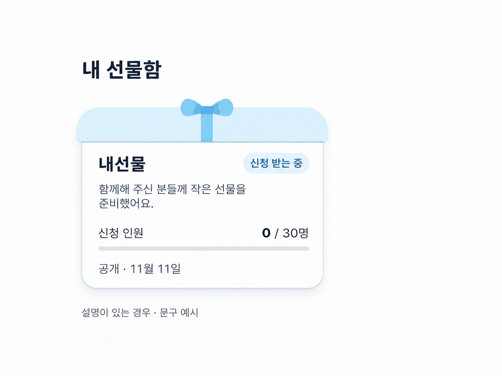

# 크리에이터 선물함 카드 시안

2026-11-11 사용자가 요청한 선물상자 형태의 카드 디자인이다. 설명이 포함된 최종 이미지 시안을 보관한다.

- 카드 전체를 흰 선물상자로 표현하고, 옅은 하늘색 뚜껑과 작은 리본을 붙인다.
- 첫 줄에는 선물함 이름과 신청 상태를 배치한다.
- 이름 아래에는 선택적으로 짧은 설명을 최대 두 줄로 표시한다. 이미지의 설명은 예시 문구다.
- 신청 인원과 전체 폭 진행 막대를 한 묶음으로 배치하고, 공개 날짜는 맨 아래에 둔다.
- 설명이 없으면 설명 영역을 접고 다음 정보를 위로 당긴다.

정보 위계와 관련 요소 묶기에는 디자인 프롬프트 1절·2절을 적용했다. 이미지 시안이므로 실제 크기와 색 대비, 긴 이름과 설명의 표시는 구현 시 확인해야 한다.
